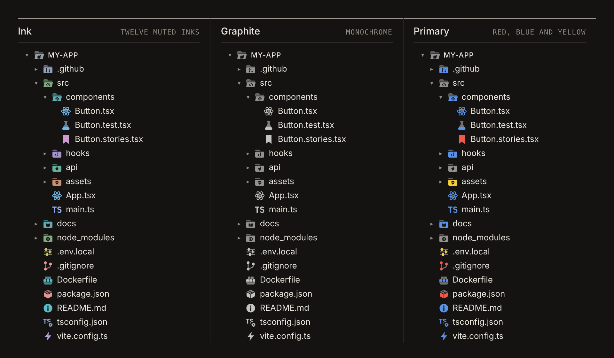
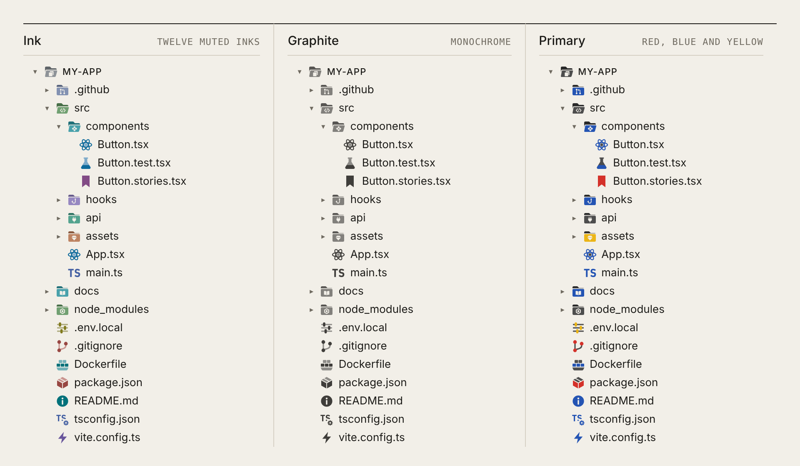
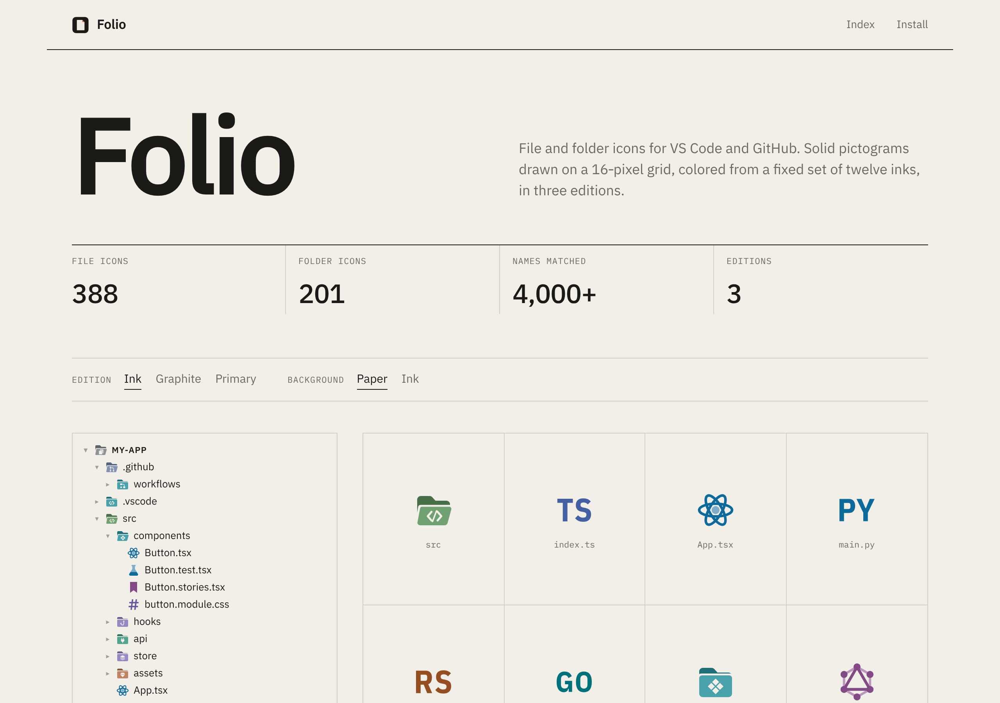

<p align="center"></p>

# Folio

File and folder icons for **VS Code** and **GitHub**.

Every icon is a solid pictogram drawn on the 16-pixel grid it is seen at. Shapes are flat; detail is cut out as
negative space. Color comes from a fixed set of twelve muted inks, so the whole set reads as one printed system.
There are no gradients, glows or shadows.

<p align="center"></p>

| | |
| --- | --- |
| File icons | 388 |
| Folder icons | 201, each with an open state |
| Names matched | 1,200+ file names, 1,100+ extensions, 6,600+ folder names |
| Editions | Ink, Graphite, Primary, each with a dark and a light set |
| Color themes | Folio Dark, Folio Light |

## Editions

- **Ink**: twelve muted inks. Related things share a hue: TypeScript and its configs are cobalt, Rust is rust.
- **Graphite**: monochrome. Shape does all the work.
- **Primary**: red, blue and yellow, after Bauhaus posters.

<p align="center"></p>
<p align="center"></p>

## Details

- **Pictograms, not logos.** Glyphs describe the idea (a database, a build, a test) rather than copy vendor marks.
  Language monograms are set in IBM Plex Sans Condensed and converted to outlines, so they never depend on
  installed fonts.
- **Folders** have a single emblem cut through the front panel. Open folders tilt forward.
- **Badges.** `tsconfig.json`, `vite.config.ts` and similar files carry a small gear; lockfiles carry a lock. The badge
  is separated from the main glyph by a cut ring rather than an outline.
- **Conventions covered:** Next.js route files (`page.tsx`, `layout.tsx`, `loading.tsx`…), semantic suffixes
  (`*.service.ts`, `*.store.ts`, `*.schema.ts`…), test files in their language's hue, and agent files
  (`CLAUDE.md`, `AGENTS.md`, `.cursorrules`, `.mcp.json`).
- **Light and dark.** Flat colors are tuned per background; VS Code switches sets automatically, and the browser
  extension follows GitHub's theme.

## Install

### VS Code

1. Download [`release/folio-icons-1.0.0.vsix`](release/folio-icons-1.0.0.vsix).
2. **Extensions** → `…` → **Install from VSIX…** (or `code --install-extension folio-icons-1.0.0.vsix`).
3. **Preferences: File Icon Theme** → **Folio Ink**, **Folio Graphite** or **Folio Primary**.
4. Optional: **Preferences: Color Theme** → **Folio Dark** or **Folio Light**.

### Chrome, Edge, Brave, Arc

1. Open `chrome://extensions` and turn on **Developer mode**.
2. **Load unpacked** and select [`extensions/chrome`](extensions/chrome)
   (or unzip [`release/folio-chrome-1.0.0.zip`](release/folio-chrome-1.0.0.zip)).
3. Open any repository on GitHub. Choose an edition from the toolbar button.

<p align="center"></p>

The extension covers the repository file table, the code-view file tree, the pull-request file tree and the older
file list. It paints onto GitHub's existing icon elements instead of inserting new ones, so it doesn't interfere with
GitHub's rendering. It needs only the `storage` permission.

### Icon index

[`docs/index.html`](docs/index.html) lists every icon with the names it matches, in every edition, on paper or ink.
It is also the extension's options page. Enable **GitHub Pages** for `/docs` to publish it.

<p align="center"></p>

## Development

```bash
npm install
npm run build      # render every edition, write the VS Code themes, bundle the extension and index
npm test           # theme checks + Chrome extension end-to-end tests (Playwright)
npm run package    # release/folio-icons-<v>.vsix and release/folio-chrome-<v>.zip
```

```
src/core/
  glyphs.js       pictogram library (16-unit grid)
  files.js        file icons and the names/extensions they match
  folders.js      folder icons and the directory names they match
  editions.js     Ink, Graphite and Primary palettes (OKLCH)
  render.js       flat SVG renderer shared by VS Code and the browser
  resolve.js      name → icon resolution (VS Code precedence)
src/runtime/      browser runtime: on-demand rendering and caching
src/gallery/      the icon index page
src/themes/       Folio Dark and Folio Light color themes
extensions/vscode VS Code extension (icons and themes are generated)
extensions/chrome Manifest V3 extension (dist/ is generated and committed so Load unpacked works)
scripts/          build, packaging and preview rendering
tests/            theme validation and browser end-to-end tests
```

### Adding an icon

1. Draw or reuse a glyph in `src/core/glyphs.js`: `f`/`f2` fill in the main/secondary tone, `s`/`s2` stroke,
   `k`/`ks` cut through everything drawn before.
2. Add an entry to `src/core/files.js` or `src/core/folders.js` with a `hue` and its names or extensions.
3. `npm run build && npm test`. The build fails on duplicate associations or missing glyphs, and the tests fail if
   any icon picks up a gradient, filter or opacity.

## License

MIT. Monograms derive from IBM Plex Sans Condensed; the index and popup use IBM Plex Sans and Mono
(SIL Open Font License 1.1).
