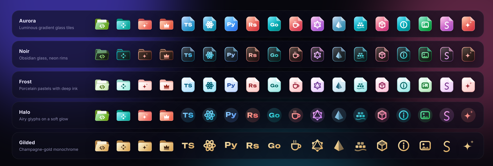
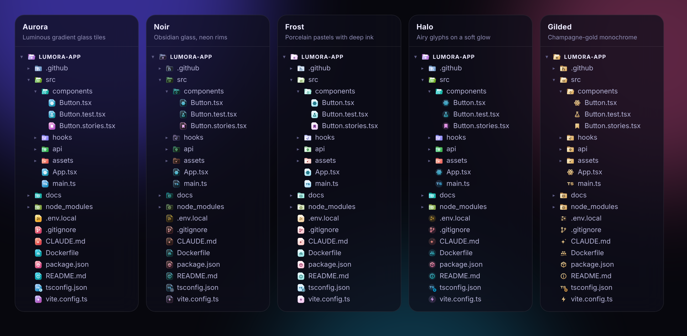
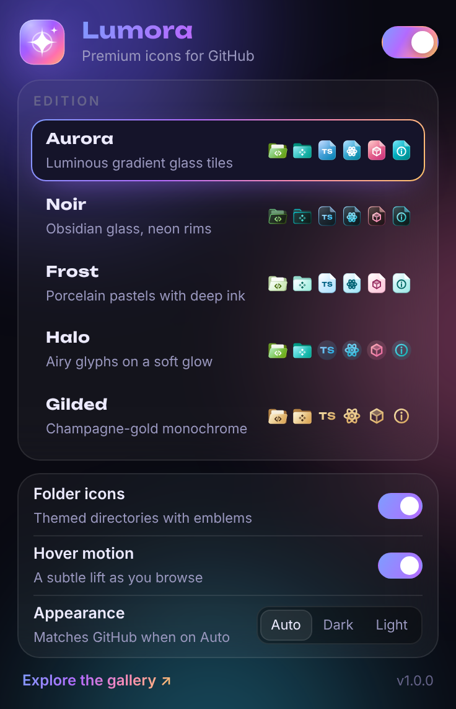
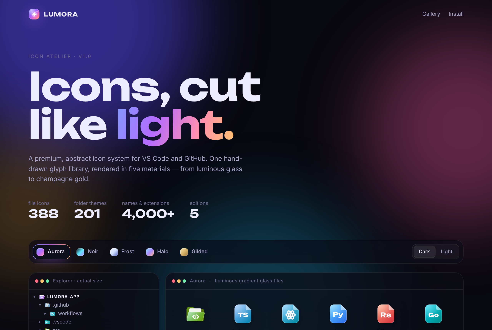

<p align="center">
  
</p>

<h1 align="center">Lumora</h1>
<p align="center"><b>Icons, cut like light.</b><br/>A premium, abstract file &amp; folder icon system for <b>VS Code</b> and <b>GitHub</b>.</p>

<p align="center">
  
</p>

Lumora is one hand-drawn glyph library rendered in **five materials**. Every icon is generated from the
same source by a tiny renderer that runs both at build time (VS Code) and live in the browser (GitHub),
so the two surfaces always match.

| | |
| --- | --- |
| **388** file icons | **201** folder themes, each with an open state |
| **1,200+** file names · **1,100+** extensions | **6,600+** folder names (incl. `.name`, `_name`, `__name__`) |
| **5** editions + light-theme sets | **2** companion VS Code color themes |

## The five editions

| Edition | Material |
| --- | --- |
| ✦ **Aurora** | Luminous gradient glass tiles with a folded "folio" corner — the signature look |
| ✦ **Noir** | Obsidian tiles, neon rims and glowing glyphs |
| ✦ **Frost** | Porcelain pastel tiles with deep ink — made for light themes |
| ✦ **Halo** | Airy gradient glyphs floating on a soft tinted halo |
| ✦ **Gilded** | Champagne-gold monochrome glyphs — quiet luxury |

<p align="center"></p>

### Design details

- **Perceptual color.** Every hue is computed in OKLCH, so a pink and a teal icon carry the same visual weight.
  Yellow tiles automatically switch to dark ink for contrast; Halo and Gilded ship separate, deeper light-theme sets.
- **Abstract, not logos.** Glyphs describe the idea (a database, a build, a test) instead of copying vendor marks.
  Language monograms are set in [Unbounded](https://github.com/w3f/unbounded) and converted to outlines, so icons
  never depend on installed fonts.
- **Folders with a story.** Each folder theme has a centered emblem; open folders tilt forward and reveal a sheet of paper.
- **Smart badges.** `tsconfig.json`, `vite.config.ts` and friends get a config badge; lockfiles get a lock badge;
  test files keep the flask but take on their language's hue.
- **Modern conventions.** Next.js route files (`page.tsx`, `layout.tsx`, `loading.tsx`, `not-found.tsx`…),
  semantic suffixes (`*.service.ts`, `*.store.ts`, `*.schema.ts`…), and AI-agent files (`CLAUDE.md`, `AGENTS.md`,
  `.cursorrules`, `.mcp.json`) all have dedicated icons.

## Install

### VS Code

1. Download [`release/lumora-icons-1.0.0.vsix`](release/lumora-icons-1.0.0.vsix).
2. In VS Code: **Extensions** → `…` menu → **Install from VSIX…** (or `code --install-extension lumora-icons-1.0.0.vsix`).
3. Run **Preferences: File Icon Theme** and pick **Lumora Aurora**, **Noir**, **Frost**, **Halo** or **Gilded**.
4. Optional: **Preferences: Color Theme** → **Lumora Midnight** or **Lumora Daybreak**.

### Chrome · Edge · Brave · Arc (GitHub)

1. Open `chrome://extensions` and switch on **Developer mode**.
2. Click **Load unpacked** and select the [`extensions/chrome`](extensions/chrome) folder
   (or unzip [`release/lumora-chrome-1.0.0.zip`](release/lumora-chrome-1.0.0.zip) and select that).
3. Browse any repository on GitHub. Use the toolbar popup to switch editions live.

<p align="center"></p>

The extension recolors the repository file table, the code-view file tree, the pull-request file tree and the legacy
file grid. It paints icons onto GitHub's existing octicon elements instead of inserting new nodes, so it never fights
GitHub's React rendering. It follows GitHub's light/dark mode automatically, and only needs the `storage` permission.

### Gallery

[`docs/index.html`](docs/index.html) is an interactive atelier: switch editions and canvases, search every name,
and see the icons at real explorer size. It also opens from the extension's options page. To host it, enable
**GitHub Pages** for the `/docs` folder.

<p align="center"></p>

## Development

```bash
npm install
npm run build      # render every edition, write VS Code themes, bundle the Chrome extension + gallery
npm test           # VS Code theme checks + Chrome extension end-to-end tests (Playwright)
npm run package    # release/lumora-icons-<v>.vsix and release/lumora-chrome-<v>.zip
```

```
src/core/
  glyphs.js       hand-drawn glyph library (24-unit grid)
  files.js        file icons + associations (names, extensions, language ids)
  folders.js      folder themes + names
  editions.js     the five materials, computed in OKLCH
  render.js       SVG renderer shared by VS Code and the browser
  resolve.js      name → icon resolution (VS Code precedence rules)
src/runtime/      browser runtime (on-demand rendering + caching)
src/gallery/      the atelier page
src/themes/       Lumora Midnight & Daybreak color themes
extensions/vscode VS Code extension (icons/themes are generated)
extensions/chrome Manifest V3 extension (dist/ is generated and committed so "Load unpacked" just works)
scripts/          build, packaging and image rendering
tests/            theme validation + browser end-to-end tests
```

### Adding an icon

1. Pick or draw a glyph in `src/core/glyphs.js` (24×24 grid; `s()` for strokes, `f()` for fills, `o` for a secondary tone).
2. Add an entry to `src/core/files.js` or `src/core/folders.js` with a `hue` and its names/extensions.
3. `npm run build && npm test` — the build fails on duplicate associations or missing glyphs.

## License

MIT. Monogram outlines derive from the Unbounded typeface (SIL Open Font License 1.1).
